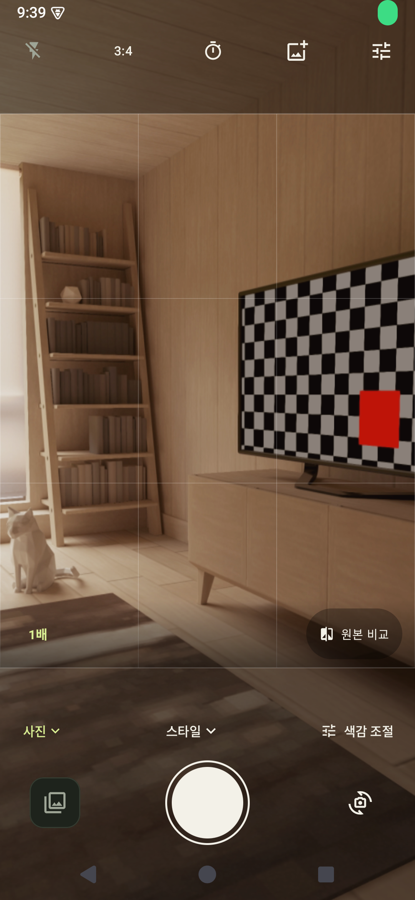
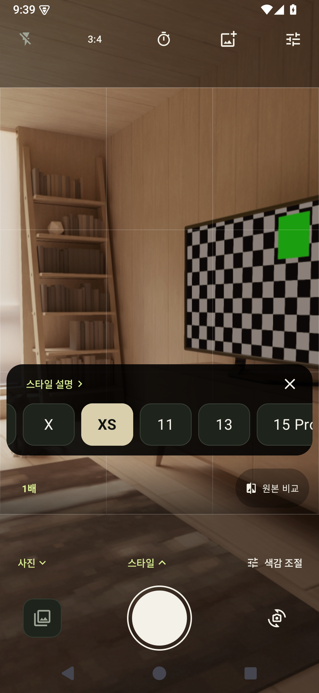

# 모먼트

아이폰 기종에서 영감을 얻은 색감을 골라 사진을 찍고 편집하는 안드로이드 앱입니다. 화면과 안내 문구는 한국어로 제공하며 Android 8.0(API 26) 이상에서 실행할 수 있습니다. Kotlin, Jetpack Compose, CameraX로 만들었습니다.

Play Console에 올릴 [서명된 AAB를 다운로드하세요](https://github.com/hyunjun1234/Iphone_camera/releases/download/v0.2.5/moment-0.2.5-7.aab). 현재 버전은 `0.2.5`, 버전 코드는 `7`입니다. **App Bundle 업로드란에는 이 `.aab` 파일 하나만 선택하세요.** APK는 휴대폰 직접 설치용 파일입니다. 배포 파일과 설명은 [GitHub Releases](https://github.com/hyunjun1234/Iphone_camera/releases/tag/v0.2.5)에서 확인할 수 있습니다.

현재 색감은 직접 조정한 프리셋입니다. 실제 아이폰 사진에서 측정한 보정값은 아닙니다. [자료 출처와 한계](docs/COLOR_EVIDENCE.md)에 사양 조사, 촬영 리뷰, 앱에서 정한 수치를 구분해 정리했습니다.

아이폰 8을 포함한 9개 기종의 공개 수치와 프리셋 조사 결과는 [공개 색감 설정값 조사](docs/PUBLIC_COLOR_RECIPES.md)에서 확인할 수 있습니다. 원문 앱의 설정값이며 모먼트에 그대로 입력하는 값은 아닙니다. 직접 확인한 숫자와 파일을 확보하지 못한 후보를 구분해 기록했습니다.

## 화면 미리보기

버전 0.2.5를 Android 15 에뮬레이터에서 실행한 화면입니다. 방은 에뮬레이터의 테스트 장면으로, 갤럭시 실기기 촬영 결과는 아닙니다.

| 기본 촬영 화면 | 스타일 선택 펼침 |
| --- | --- |
|  |  |

[9:16 촬영](docs/screenshots/camera-wide.png), [1:1 촬영](docs/screenshots/camera-square.png), [색감 조절 화면](docs/screenshots/tune.png)도 확인할 수 있습니다. [스타일 설명](docs/screenshots/styles.png), [사진 편집](docs/screenshots/import.png), [앱 정보](docs/screenshots/about.png)는 버전 0.2.1의 기록입니다.

카메라 영상이 화면 전체에 이어집니다. 선택한 촬영 영역 바깥은 밝기를 약 60%로 낮춰 표시하며, 사진에는 테두리 안의 영역만 저장됩니다. 3:4, 9:16, 1:1로 바꿔도 바깥 영상은 그대로 이어집니다. 스타일 목록은 처음에는 접혀 있고, 하단의 **스타일** 버튼으로 열거나 닫습니다. **닫기** 버튼과 뒤로 가기도 사용할 수 있으며, 목록을 열어도 미리보기의 크기와 구도는 바뀌지 않습니다.

## 실행

Android Studio에서 프로젝트를 열고 Gradle을 동기화하세요. SDK 36과 JDK 17 이상이 필요합니다.

```sh
./gradlew assembleDebug testDebugUnitTest lintDebug
adb install -r app/build/outputs/apk/debug/app-debug.apk
```

macOS에서는 Android Studio에 포함된 JDK를 사용할 수 있습니다.

```sh
export JAVA_HOME="/Applications/Android Studio.app/Contents/jbr/Contents/Home"
./gradlew assembleDebug
```

## 제공 기능

- 아이폰 6s, 7, 8, X, XS, 11, 13, 15 Pro, 16을 주제로 한 9개 스타일. 처음에는 XS를 선택하며, 스타일별로 조절한 값을 다음 실행에도 기억합니다.
- 실시간 색감 미리보기, 강도와 온도 및 대비 조절, 원본 비교. 조절창은 사진을 가리지 않으며 초기화는 현재 항목에만 적용합니다.
- 전후면 사진 촬영, 터치 초점, 길게 눌러 초점 고정, 핀치 줌, 노출 보정, 플래시
- 볼륨 버튼 촬영, 3초와 10초 타이머, 구도 격자, 3:4와 9:16 및 1:1 촬영 비율
- 지원되는 기기에서 제조사의 자동 보정, HDR, 야간 촬영, 인물 사진 사용
- 원본 별도 저장, 최근 사진을 갤러리에서 바로 열기, 기존 사진을 가져와 새 파일로 편집. 사진 공유는 열린 갤러리 앱에서 할 수 있습니다.
- 카메라 권한 없이 사진 가져오기 가능. 앱에 네트워크 권한이나 분석 SDK가 없으며 색감은 기기에서 처리합니다.

초점과 노출, 줌, 플래시의 사용 범위는 카메라 하드웨어에 따라 다릅니다. 초점 고정은 자동 노출 고정을 뜻하지 않습니다. [기능별 지원 범위와 검토 결과](docs/RELEASE_REVIEW.md)를 확인하세요.

## Google Play 내부 테스트 준비

업로드용 키로 서명한 AAB와 설치용 APK를 만드는 명령을 추가했습니다.

```sh
python3 scripts/prepare_play_release.py
```

서명 설정이 없으면 중단하며, 결과는 `app/build/outputs/play/`에 저장합니다. 새 앱의 키 생성, 기존 키 사용법, Console 등록 순서는 [내부 테스트 배포 안내](docs/PLAY_INTERNAL_TESTING.md)에 정리했습니다. 키와 비밀번호는 Git 저장소 밖에 보관합니다.

GitHub에 첨부된 AAB를 받아 Console에서 직접 내부 테스트로 등록할 수 있습니다. GitHub 파일 배포와 Google Play 테스트 게시는 별도 절차입니다.

## 저장 방식과 제한

미리보기와 저장에는 같은 33×33×33 색상 변환표를 사용합니다. 카메라의 미리보기 처리와 정지 사진 처리, JPG 압축 과정 때문에 두 결과의 모든 픽셀이 같지는 않습니다.

편집본은 SDR sRGB JPG로 저장합니다. 최대 약 1,600만 화소이며 기기의 메모리에 따라 더 작아질 수 있습니다. 투명한 사진은 흰 배경을 넣은 뒤 색감을 적용합니다. 촬영 사진은 선택한 프레임으로 잘라 원본과 보정본을 저장합니다. 촬영 원본은 색감을 적용하지 않은 JPG이며, 센서 전체를 보존하는 RAW 파일은 아닙니다. 전체 화면 영상에서 일부 영역을 저장하므로 이전 버전보다 화각과 저장 화소 수가 줄어들 수 있습니다. 가져온 사진은 이 촬영 프레임으로 자르지 않으며, 원본 파일도 변경하지 않습니다. 새로 만드는 촬영 사진과 편집본에는 위치 정보를 복사하지 않습니다.

동영상, 연속 촬영, 파노라마, 수동 ISO와 셔터 속도, RAW 촬영은 제공하지 않습니다. 삼성 기본 카메라의 모든 렌즈와 전용 모드를 그대로 사용할 수 있는 앱도 아닙니다. 기본 카메라로 촬영한 사진을 가져올 수 있지만, JPG 편집본에는 RAW 데이터나 Ultra HDR 게인맵이 유지되지 않습니다.

## 검증

0.2.5에서는 최근 사진을 눌러 외부 갤러리를 여는 흐름과 카메라 복귀, 밝기 60%의 촬영 영역 바깥 화면을 배포용 APK로 확인했습니다. 빌드와 린트 및 AAB 서명도 검증했습니다.

2026-10-27 기준, 버전 0.2.4에서 아래 항목을 통과했습니다.

- 디버그 APK, 최적화된 릴리스 APK와 AAB 빌드
- 단위 테스트 14개: 색상 변환, 경계값, 촬영 방향, 촬영 영역의 회전과 반전, 투명 픽셀 처리
- Android 통합 테스트 16개: 촬영과 비율 변경, 전후면 전환, 스타일별 조절값 보존, 원본 비교, 사진 저장과 편집, 스타일 목록을 접어도 촬영 구도와 선택이 유지되는지 검증했습니다. 화면 전체의 카메라 영상, 세 비율의 연속 촬영과 원본 및 보정본의 크롭도 검사했습니다.
- 360×720dp 화면과 글자 크기 130%에서 사용성 테스트 5개 추가 통과. 촬영 화면의 크기, 스타일 목록 접기, 사진과 조절창의 배치 검증
- `lintDebug` 오류 0개. 업데이트 권장과 세로 화면 고정 등을 포함한 경고는 남아 있습니다.
- 릴리스 APK에 네트워크 권한이 없는 것 확인

통합 테스트는 API 35 ARM64 에뮬레이터에서 실행했습니다. GitHub Actions의 `Android camera checks`를 직접 실행하면 별도의 API 35 x86_64 에뮬레이터에서 검사하고 실제 화면과 결과를 아티팩트로 남깁니다. 이 작업에는 배포용 서명 키를 사용하지 않습니다. 테스트가 앱 설정을 초기화하므로 테스트용 설치에서 실행하세요.

```sh
./gradlew connectedDebugAndroidTest
./gradlew bundleRelease
```

갤럭시 실기기의 확장 촬영 기능, 장시간 발열과 메모리 사용, 실제 아이폰과의 색상 비교는 아직 검증하지 않았습니다. 업로드용 서명은 준비했으며, 정식 출시에는 Console의 앱 서명 설정과 운영자 정보, 개인정보처리방침 등 추가 준비가 필요합니다. 기술 구조와 실측 계획은 [조사 문서](docs/RESEARCH.md)에 정리했습니다.
