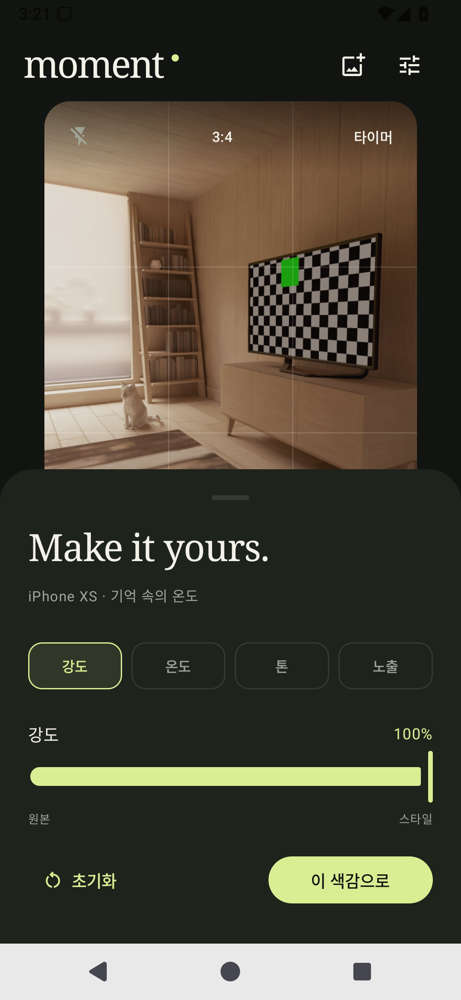

# moment — Android camera

갤럭시로 찍고, 좋아하는 아이폰의 분위기로 남기는 오프라인 카메라 앱입니다. Kotlin · Jetpack Compose · CameraX로 구현했습니다. Android 8.0(API 26) 이상을 지원합니다.

## 화면 미리보기

Android 15 에뮬레이터에서 실행한 실제 앱 화면입니다. 카메라 속 방은 에뮬레이터의 테스트 장면입니다.

| 촬영 · 모델 선택 | 실시간 색감 조절 |
| --- | --- |
|  |  |

## 실행

Android Studio에서 이 폴더를 열고 Gradle 동기화 후 실제 Android 기기에 실행하세요. SDK 36과 JDK 17 이상이 필요합니다.

```sh
./gradlew assembleDebug testDebugUnitTest lintDebug
adb install -r app/build/outputs/apk/debug/app-debug.apk
```

macOS에서 Java가 없다면 Android Studio에 포함된 JDK를 사용할 수 있습니다.

```sh
export JAVA_HOME="/Applications/Android Studio.app/Contents/jbr/Contents/Home"
./gradlew assembleDebug
```

## 제공 기능

- iPhone 6s · 7 · X · XS · 11 · 13 · 15 Pro · 16에서 영감을 얻은 8개 프리셋. XS가 최초 기본값이며 마지막 설정을 기억합니다.
- GPU 실시간 색감 미리보기와 저장 사진에 같은 33³ 3D LUT 사용. 강도·온도·톤 조절, 원본 길게 눌러 비교.
- 실제 사진 촬영, 탭 초점, 핀치 줌, 노출 보정, 플래시, 전후면 전환, 타이머, 구도 격자, 3:4 / 9:16 / 1:1 촬영.
- CameraX Extensions가 공개된 기기에서는 제조사의 자동·HDR·야간·인물 처리를 사용. 렌즈별 지원을 감지하고 사용할 수 없는 모드는 비활성화합니다.
- 원본 별도 보관, 갤러리 저장, 최근 사진 열기·공유, 시스템 사진 선택기로 기존 사진에 색감 적용.
- 카메라 권한이 없어도 사진 가져오기 가능. 네트워크 권한과 서버 전송 없음.

## 구현 범위

이 프리셋은 실제 iPhone의 측정 프로파일이 아닌 **창작 색감 근사치**입니다. Apple ISP, Smart HDR, Deep Fusion, 렌즈·센서를 복제하지 않습니다. 원본 갤럭시 JPEG에 이미 적용된 샤프닝과 로컬 톤 매핑도 완전히 되돌릴 수 없습니다. 서로 다른 기기·조명에서 동일한 결과를 보장하지 않습니다.

삼성 기본 카메라의 Expert RAW, 200MP, Super Steady, Space Zoom 같은 전용 기능 전체를 CameraX에 가져올 수 없습니다. 해당 기능이 필요한 사진은 기본 카메라로 촬영한 뒤 앱의 **사진 가져오기**로 처리하세요. Extensions와 GPU 효과 조합을 기기가 거부하면 일반 촬영으로 복구하고 안내합니다. 출력은 SDR sRGB JPEG이며 Ultra HDR 게인맵·HEIF·RAW를 유지하는 편집기가 아닙니다. 현재 버전은 정지 사진에 집중하며 동영상은 제공하지 않습니다.

조사 근거, 프리셋 설계, 실제 기기에서 확인할 항목은 [docs/RESEARCH.md](docs/RESEARCH.md)를 참고하세요.

## 검증 결과

2026-10-26, Android 15 / API 35 ARM64 에뮬레이터에서 확인했습니다.

- 디버그 APK 빌드 성공: `app/build/outputs/apk/debug/app-debug.apk` (약 20MB)
- 색감 엔진 단위 테스트 7개 통과: 원본 보존, LUT 경계, 계조의 연속성, 텍스처 배치, 파라미터 제한, 프리셋 차이
- Android 통합 테스트 3개 통과: 실제 미리보기·후면 촬영·전면 촬영·1:1 크롭, 모델/설정 유지, EXIF 회전 정규화, 원본 파일 바이트 보존, 색감 적용 JPEG 저장
- `lintDebug` 오류 없음. 라이브러리 업데이트 권장, 세로 화면 고정 등 비차단 경고가 있습니다.
- 최종 APK의 네트워크 권한 없음 확인

기기 또는 에뮬레이터를 연결하고 통합 테스트를 다시 실행할 수 있습니다. 테스트는 앱의 설정을 초기화하므로 테스트용 설치에서 실행하세요.

```sh
./gradlew connectedDebugAndroidTest
```

삼성 실기기의 Extensions, 렌즈 노출 여부, 실제 아이폰과의 색상 비교는 아직 검증하지 않았습니다. 프리셋 보정에 필요한 촬영 데이터 수집 방법은 조사 문서에 정리했습니다.
